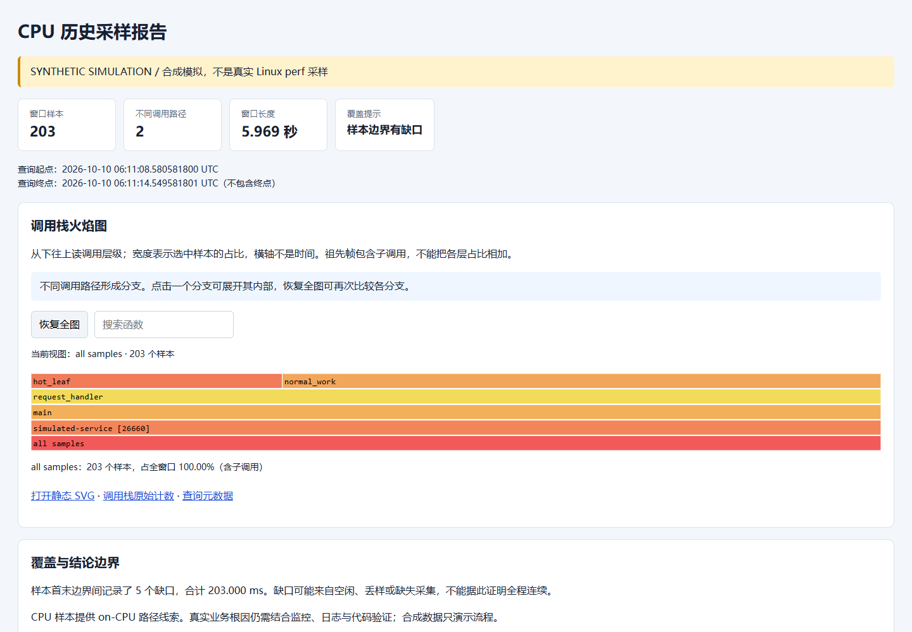

# CPU Blackbox

Linux 持续 CPU Profiling 工具：perf 常驻采样、原生轮转、磁盘保护、历史时间回查和离线火焰图。故障恢复后仍可查看保留的历史现场。

**当前交付包含完整实现与本地验证。Windows 可运行合成流程和逻辑测试；真实 Linux/perf、业务损耗 <3% 和 7x24 仍需目标环境验收。**

## 快速运行

需要 Python >=3.9，主程序只依赖标准库，无需联网安装 Python 包。先进入解压后的 cpu-blackbox 目录：

```bash
python -m cpu_blackbox --help
python -m unittest discover -s tests -v
python tools/start_demo.py --no-browser
```

Linux 可使用 python3。Windows 可双击 run_demo.cmd 和 run_tests.cmd；Python 仅在 Anaconda Prompt 可用时，在该终端运行这两个文件。演示生成新的 runs/demo-* 目录；省略 --no-browser 会尝试打开报告。

本地打开 [随包最新演示](artifacts/demo/report/index.html)；GitHub 文件浏览页展示 HTML 源码，下载或运行演示后可查看交互页面。故障、紧邻等长基线、完整时段各保留一份报告，来源明确标记 SYNTHETIC。合成流程启动采集进程、运行 6 秒并每 1 秒轮转，待热点结束后使用同一查询实现回溯。

指定新的输出目录：

```bash
python tools/run_simulation_demo.py --output-root runs/manual-demo
```

输出目录必须不存在。模拟不包含 Linux 内核，不测量 Windows CPU，不能用于证明真实业务根因。全窗口样本只有一路调用链时，各层同宽符合统计。

## 目录

```text
cpu_blackbox/                 CLI、采集监督、存储、查询、模拟、页面
deploy/                       systemd 服务模板与 PID 环境文件
tools/                        演示、性能验收、页面检查、导出、打包
tests/                        单元、故障回归、真实 Linux 集成测试
skills/cpu-profiling/SKILL.md  可复用操作流程
docs/                         设计、systemd、测试、交付清单
artifacts/demo/               唯一随包演示与浏览器证据
artifacts/test-*              实际测试日志和汇总
artifacts/git-history.*      网页上传所需的历史备份与范围说明
```

## Linux 真实采集

需要与目标内核适配的 perf、目标 PID 采集权限和可展开的调用栈。doctor 对指定 PID 做短时真实附着探测，不修改内核权限限制。

```bash
python3 -m cpu_blackbox --config config.example.json doctor --pid 1234
python3 -m cpu_blackbox --data-dir ./data --config config.example.json collect --pid 1234
python3 -m cpu_blackbox --data-dir ./data status
```

替换为实际业务 PID。全局 --data-dir、--config、--perf 位于子命令之前。collect 是前台监督进程，后台常驻由 deploy/cpu-blackbox.service 管理；专用用户、数据目录、权限、启停和验收步骤见 [SYSTEMD.md](docs/SYSTEMD.md)。

目标退出或 PID 复用时结束当前会话，不自动跟踪重启后的新 PID。fp 需要目标保留帧指针；DWARF 必须另测开销。保留对应二进制、调试符号和 build ID cache，以解析升级前的历史记录。JIT/解释器栈需要额外运行时支持。

## 历史时间查询与火焰图

```bash
python3 -m cpu_blackbox --data-dir ./data --config config.example.json query --at 2026-10-10T03:00:00+08:00 --before 30 --after 30 --output ./reports/incident-0300
python3 -m cpu_blackbox --data-dir ./data --config config.example.json query --start 2026-10-10T02:59:50+08:00 --end 2026-10-10T03:00:20+08:00 --output ./reports/window
```

时间必须携带时区。输出 index.html、flamegraph.svg、stacks.folded、report.json；报告必须是新目录且位于采集目录之外。点击函数缩放，搜索高亮，恢复全图；缩放保持图高与字体比例稳定。宽度表示样本数量，横轴不是时间，inclusive 父子占比不能相加。

- 查询限于已封口且仍保留的分片，最新可见延迟是一个轮转周期加解析耗时。
- 跨片逐样本使用整数纳秒 `[start,end)` 和 PID 过滤，可用 --session 指定会话。
- 墙上时间由会话锚点映射到 perf 的 CLOCK_MONOTONIC，报告可观测误差；时钟跳变会话拒绝自动映射。
- 不兼容的事件、频率、栈展开或真实/合成来源不能混合。
- 样本首末边界缺口可能是空闲、丢样或缺失采集，不能证明全程连续；无匹配样本时明确报错。

退出码：0 正常；2 错误；3 已生成部分样本覆盖报告或状态陈旧；75 磁盘压力停止。退出码 3 对应的报告仍应保留。

## 配置、轮转与容量

复制 config.example.json 后调整；未指定项使用下表默认值：

| 字段 | 默认值 | 含义 |
| --- | --- | --- |
| event | cpu-clock | 也可用 cycles，需 doctor 实测 |
| frequency_hz | 49 | 采样频率，整体开销需压测 |
| call_graph | fp | 也可用 dwarf,4096 / dwarf,8192 |
| rotation_seconds | 60 | 原生轮转周期，秒 |
| retention_hours | 24 | 最长保留时长，小时 |
| max_data_bytes | 2147483648 | 数据目录预算，2 GiB |
| min_free_bytes | 1073741824 | 最低空闲空间，1 GiB |
| disk_check_seconds | 5 | 磁盘检查周期，秒 |
| perf_timeout_seconds | 120 | 每次 perf script 解码时限，秒 |
| max_query_seconds | 3600 | 单次查询最大跨度，秒 |
| max_decode_bytes | 268435456 | 解码 stdout/stderr 预算，256 MiB |
| max_report_bytes | 67108864 | 报告预算，64 MiB |
| clock_jump_ns | 100000000 | 时间偏移跳变阈值，100 ms |

数值须为有限正数，整数字段按配置校验。默认参数是起点，不是已通过性能验收的生产参数。

perf 原生 --switch-output 持续轮转，避免每片重新附着。监督进程检查 perf 的活跃文件描述符，只发布已关闭文件；无法确认封口时失败。解码失败记 CORRUPT，超时或资源不足记 UNINDEXED 并保留原文件。停止采集、调整限制后可重试：

```bash
python3 -m cpu_blackbox --data-dir ./data --config config.example.json reindex
```

清理按保留期、目录容量和磁盘空闲删除最老封口片，保护 ACTIVE。预算包含数据库、日志、buildids、解码和查询快照。低空间先清理，仍不足停止采集；systemd 对退出码 75 禁止自动重启。

预算是软阈值，硬上限需文件系统配额；build ID cache、历史日志与 SQLite 空间需维护。崩溃遗留 query-pinned-* 只能在确认无查询运行后处理。索引采用绝对文件路径，当前不支持搬迁旧数据目录。

## 设计说明

```text
systemd → Python 监督进程 → perf record → 原生轮转
                                    → 验证封口 → perf script → SQLite 索引

历史窗口 → 时间映射 → 锁内选择/快照复制 → 解码与时间/PID 过滤
         → 合并调用栈计数 → 离线 HTML/SVG/folded stacks/JSON
```

perf 执行采样与原生轮转，Python 标准库管理生命周期和资源，SQLite WAL 登记会话/锚点/分片，自带 SVG/HTML 用于离线查看，不依赖 CDN、Perl 或 Web 服务。

collector.lock 防重复采集，query.lock 限单个并发查询，storage.lock 保护选择/复制/删除。查询复制稳定快照后释放锁，后续清理不会破坏输入。身份包含 PID、启动时间和 boot ID；停止先向 perf 发 SIGINT 封口，超时强杀并记录故障。恢复核对遗留 perf，避免重复采集。

完整状态、恢复、时间模型和资源边界见 [DESIGN.md](docs/DESIGN.md)。

## 测试与性能验收

```bash
python -m unittest discover -s tests -v
```

命令与依赖见 [tests/README.md](tests/README.md)，实际执行见 [TEST_REPORT.md](docs/TEST_REPORT.md)、artifacts/test-results.txt 与 test-summary.json。Node.js 交互检查为可选项，缺失时明确跳过；真实集成另需 Linux/perf/gcc/权限。跳过不能作为通过。

tools/benchmark.py 对真实持久业务 PID 做至少五轮交错 A/B。负载命令 stdout 输出吞吐、P95/P99、错误率和时长 JSON：

```json
{"throughput":10000,"p95_ms":12,"p99_ms":25,"error_rate":0,"duration_seconds":120}
```

```bash
python3 tools/benchmark.py --pid 1234 --config config.example.json --runner-json '["python3","load_runner.py"]' --rounds 5 --output artifacts/benchmark-real
```

每轮至少覆盖两次轮转，吞吐损耗的保守置信上界 <3% 才标记该负载通过；尾延迟与错误率另按 SLO 审查。需包括采样、轮转、索引和清理的整体开销，当前没有真实性能结果。

本项目仓库交付，包含源码、提交历史和真实本地验证记录。清单见 [DELIVERY.md](docs/DELIVERY.md)，上传步骤见 [GITHUB.md](docs/GITHUB.md)。运行数据和历史输出归档均不跟踪，随包只保留一份最新演示。

真实环境仍需验收 perf 兼容性、符号质量、systemd 生命周期、代表性业务 <3%、7x24 与故障注入。当前不支持服务 PID 自动发现、整机/容器采集、off-CPU 和通用 JIT 栈。

参考：[perf record](https://man7.org/linux/man-pages/man1/perf-record.1.html)、[perf script](https://www.man7.org/linux/man-pages/man1/perf-script.1.html)、[perf security](https://cdn.kernel.org/doc/html/latest/admin-guide/perf-security.html)。

## 火焰图预览

以下为真实浏览器打开合成数据报告的截图，非真实 Linux perf 采样：


